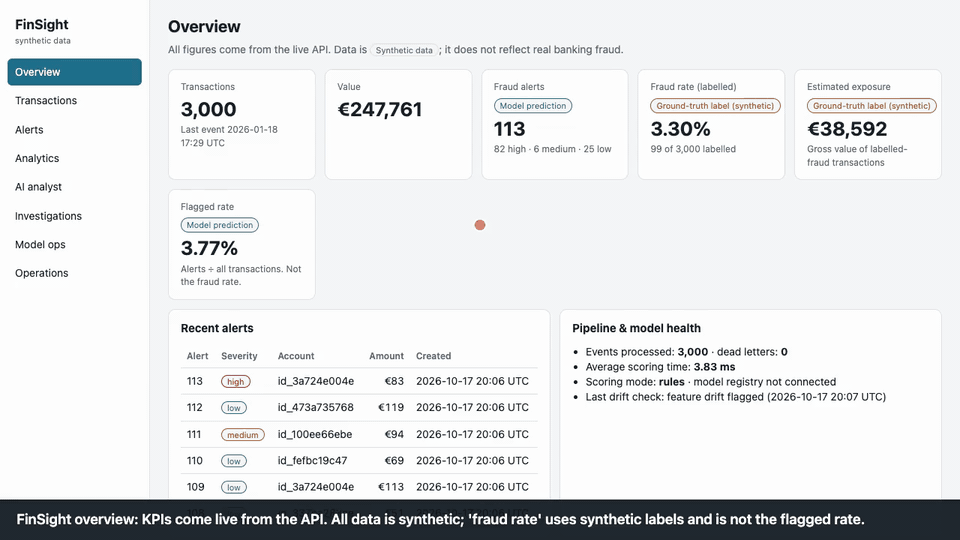

# FinSight

A banking fraud-analytics platform built end to end on **synthetic** transactions: streaming ingestion and fraud scoring, a tested analytics warehouse, a gated MLOps loop, a guarded Text-to-SQL analyst, an evidence-grounded investigator with human approval, and an analyst dashboard. **Not production-ready.**

[](https://github.com/nithya-prakash/FinSight/actions/workflows/ci.yml)   



*Dashboard walk-through on synthetic data, without an API key: overview, live transactions, an alert and its evidence, an investigation draft with a two-step human confirmation (not confirmed in the recording), the AI analyst's labelled reference query, analytics and operations.* [Full-quality MP4](docs/demo.mp4) (re-record with `scripts/record_demo.py`).

> All data is synthetic and fictional. FinSight does not demonstrate validated performance against real financial fraud, is not a compliance product, and has not been deployed to any cloud. Investigation reports are educational SAR-style drafts, never regulatory filings. **Real Claude answer quality has not been verified**: no successful live Anthropic call was made during development.

## Results

Every number below was produced by a command in this repository on synthetic data; read them as "the pipeline works", not as fraud-detection accuracy.

| Component | Result | Evidence |
|---|---|---|
| Streaming ingestion and scoring | 3,000 events: 3,000 processed, 69 alerts, 0 dead letters; scoring p50 / p95 about 1.1 / 3.6 ms (local, rules mode); redelivery produces no duplicate rows or alerts | live run; p50/p95 matches an independent SQL percentile |
| Consumer reliability | broker lag 0 → 253 with the consumer stopped → 0 after restart; 3 malformed events dead-lettered and counted | live run |
| Fraud model (XGBoost, 26 shared online/offline features) | PR-AUC on a chronological holdout **0.95**; rules baseline **0.53**; logistic regression 0.87 (validation: 0.89 / 0.27 / 0.75) | `finsight ml train` on the `ml` profile (about 60k synthetic transactions); simple, clean fraud patterns, so scores are optimistic |
| Leakage controls | labels and scenario names excluded from features; features unchanged when labels are flipped or future events removed; online and offline features equal | tests |
| Warehouse | 105 dbt nodes (models and data tests) pass; marts match an independent Python calculation of volume, fraud rate, confusion matrix and category exposure | tests |
| Text-to-SQL safety | 34 attack queries (DDL/DML, stacked statements, system catalogs, dangerous functions, restricted tables) all rejected; read-only database role blocks writes and raw tables | CI gate; live |
| Text-to-SQL correctness | 15 of 15 golden questions: reference SQL matches independent Python answers (validates the set and the pipeline, **not** an LLM score) | `make eval` |
| LLM answer quality (SQL generation, investigator analysis) | **not measured** | needs an Anthropic key |
| Access control and privacy | 401 / 403 / 200 matrix over 15 endpoints; 0 raw identifiers in 24 API responses, error bodies, `/metrics` and container logs | live run |
| Concurrency | 6 simultaneous decisions on one investigation: 1 accepted, 5 rejected (409); repeated starts reuse the active run | live run |
| Observability | request, `bi.ask` and investigator spans reach Jaeger; no identifiers, SQL or question text in span attributes | live run |
| Tests | 187 pass, 4 opt-in skipped; ruff and mypy (54 files) clean; frontend: 9 tests, typecheck, production build; `npm audit`: 0 vulnerabilities | `docs/verification-report.md` |

## Quickstart

Prerequisites: Docker Desktop with Compose v2 (>= 6 GB RAM), about 10 GB free disk, free ports 5433, 19092, 8000, 3001 (3000, 5000, 16686 for optional profiles), `make`. Python and Node run inside containers.

```bash
cp .env.example .env                                    # placeholders for LOCAL DEMO use; change the keys and passwords
docker compose up -d --wait postgres redpanda
make migrate && make seed                               # 6 SQL migrations; seeds customers, accounts, merchants and labels (kept in a separate schema)
docker compose up -d --build --wait api fraud-consumer web
make demo                                               # streams 3,000 synthetic events through Redpanda, then builds the dbt warehouse
open http://localhost:3001                              # dashboard; API docs at http://localhost:8000/docs
```

Optional profiles: `--profile warehouse` (Dagster UI :3000), `--profile ml` (MLflow :5000), `--profile observability` (Jaeger :16686). Core stack uses about 1 GB RAM; with Dagster and MLflow 3 to 4 GB.

| Variable | Purpose |
|---|---|
| `AUTH_KEYS` | `key:role:identity,...` with roles `viewer` / `analyst`; the API fails closed (503) if unset |
| `AUTH_DISABLED` | `true` = local-demo switch, every caller acts as `local-demo` analyst; never use outside a demo |
| `API_KEY` | used only by the dashboard's server-side proxy; must equal one analyst key |
| `ANTHROPIC_API_KEY`, `BI_MODEL` | optional; enables live Claude features |
| `PII_MASK_KEY` | key for identifier pseudonyms; change it |
| `SCORING_MODE`, `ALERT_THRESHOLD` | `rules` (default) or `ml` (approved registry model, rules fallback) |
| `POSTGRES_*`, `DATABASE_URL`, `OTEL_EXPORTER_OTLP_ENDPOINT` | database credentials (dev placeholders); optional tracing export |

## How it works

`generator -> Redpanda topic finsight.transactions.v1 -> consumer -> PostgreSQL (core / eval) -> dbt marts (via Dagster) -> API -> dashboard`

- **Data:** a seeded, deterministic generator injects velocity bursts, impossible travel, mule rings, unusual spending, card testing and merchant concentration, plus benign look-alikes. Ground-truth labels live in a separate `eval` schema that features and agents cannot read.
- **Streaming:** one database transaction per event writes the transaction, score, alert and ledger row; offsets are committed after the commit (at-least-once), so redelivery is absorbed. Malformed events go to a dead-letter table.
- **Signals vs model:** interpretable rules (velocity, repeated small payments, unusual amount or category, pass-through transfers, geographic inconsistency) always run. The XGBoost model is promoted only through MLflow after a passing evaluation and a named human approver; otherwise scoring is rules-only and says so. Neither is proof of fraud.
- **Metrics:** fraud rate = labelled fraud / labelled transactions; flagged rate = alerted / all transactions (not the fraud rate); false-positive rate = FP / labelled legitimate. Definitions with denominators: `docs/data-model.md`.
- **Text-to-SQL:** schema retrieval and a version-controlled glossary, then the model's SQL must pass a default-deny sqlglot policy (one SELECT, table/column/function allow-lists, injected LIMIT) and runs on a read-only role with a 5 s timeout. Identifiers are pseudonymised and small groups suppressed. `docs/sql-security.md`.
- **Investigator:** deterministic evidence bundle with ids and provenance, a model analysis whose claims must cite evidence (uncited or number-inventing claims are dropped), a report that separates facts, model outputs, hypotheses and the human decision, then a LangGraph interrupt until a named analyst decides. No tool can touch accounts. `docs/agent-workflow.md`.
- **Access:** server-side API keys with roles; identifiers in every response are pseudonymised (`reveal_ids=true` is analyst-only and audited); the dashboard proxy keeps the key out of browser code.

## Usage

```bash
curl -H "x-api-key: dev-analyst-key-change-me" localhost:8000/alerts?severity=high
curl -H "x-api-key: dev-analyst-key-change-me" -X POST localhost:8000/bi/demo/demo_fraud_by_category   # labelled reference query (no LLM)
docker compose run --rm tools finsight ml train      # registers a candidate; also: promote --version N --approver "Name", rollback, monitor [--retrain-on-drift]
docker compose run --rm tools finsight eval text2sql --mode reference     # --mode llm needs a key
```
Without `ANTHROPIC_API_KEY`: `/bi/status` reports `llm_available: false`, typed questions return `llm_unavailable`, investigations are facts-only, and labelled reference queries still work. Put the key in `.env` (never commit it) and run `docker compose up -d --build api`.

## Evaluation method

Synthetic data from a fixed seed; model training uses a chronological 60/20/20 split with a 24 h label-maturity gap, thresholds tuned on validation by a configurable cost model, and the holdout reported once per run. SQL and investigator checks use fixture datasets whose expected answers are computed independently in Python. Real-Claude evaluation (`make live-claude`: 4 verified questions plus one unanswerable, one investigation re-checked claim by claim) is budget-capped (about $0.50 estimated, 14 calls) and double opt-in; it has never been run.

## Feature status

| Feature | Status |
|---|---|
| Streaming ingestion, rules scoring, idempotent consumer, dead letters, broker lag, health check | implemented and verified live |
| dbt warehouse (staging, intermediate, marts, 105 nodes) and Dagster job with daily schedule | implemented; Dagster verified in tests and a live run |
| XGBoost scoring with MLflow registry, gated promotion, rollback, Evidently drift monitoring | implemented and verified; retraining runs on demand or on drift, **not on a schedule** |
| Text-to-SQL agent (policy, read-only role, masking, charts) | implemented and verified; **LLM generation never run live** |
| Investigator (LangGraph, grounding checks, atomic decisions, audit trail) | implemented and verified with a scripted model; **real Claude analysis never run** |
| Dashboard (8 views), OpenTelemetry tracing, Prometheus metrics | implemented and verified |
| Per-user login / SSO, TLS, secrets manager, cloud deployment | **not implemented** |
| GitHub Actions workflow (lint, mypy, security gate, full test suite, golden set, web build, image builds) | passing on GitHub (run on commit `2ede4af`); the first run failed on a missing migration step, fixed in that commit |

## Limitations

- Synthetic, simple fraud patterns: model scores are optimistic and some features (for example an unknown device) are generator artefacts. Nothing here estimates real-world performance.
- Shared API keys with two roles; the dashboard acts as a single analyst. In-memory rate limiting covers `/bi` only. Development passwords and keys in `.env.example` are placeholders.
- Dagster and MLflow keep state in SQLite volumes; LangGraph creates its own checkpoint tables outside the migrations.
- Python lint and type checks are enforced, but the code is not auto-formatted with `ruff format`.
- No load testing and no browser end-to-end tests.

## Repository layout and checks

```
src/finsight/        generator/ pipeline/ scoring/ ml/ agents/text_to_sql/ agents/investigator/ api/ privacy.py observability.py cli.py
packages/database/   SQL migrations 0001-0006       warehouse/dbt/   dbt project       orchestration/dagster/   Dagster definitions
apps/web/            Next.js dashboard + Vitest     evals/text_to_sql/   golden questions and SQL attack set       scripts/record_demo.py
tests/               unit, integration, security, ML, warehouse, agents (+ opt-in live tests)       docs/   design, security, verification
```

```bash
make lint typecheck              # ruff + mypy
make test security               # full Python suite (real Postgres, Redpanda, dbt, Dagster, MLflow) and the fast security subset
make lint-web test-web           # TypeScript and Vitest; `cd apps/web && npm run build && npm audit` for the production build and audit
make live-network                # real api.anthropic.com with a deliberately invalid key and a real timeout (no key, no cost)
make live-claude                 # needs ANTHROPIC_API_KEY and RUN_LIVE_CLAUDE=1; budget-capped real-Claude tests (never run)
```
More: `docs/` (architecture, data dictionary, data model, event contracts, fraud model, monitoring, SQL security, agent workflow, evaluation, observability, frontend, troubleshooting, security boundaries, verification report).

## License

MIT, see [LICENSE](LICENSE).
