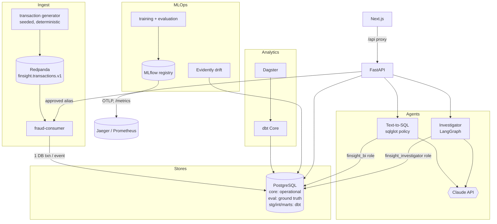

# Architecture

## Components


## Data flow of one event
```mermaid
sequenceDiagram
  participant P as Producer
  participant K as Redpanda
  participant C as Consumer
  participant D as PostgreSQL
  P->>K: TransactionEvent (event_id, schema v1, event_time)
  K->>C: deliver (at-least-once)
  C->>D: BEGIN; INSERT txn ON CONFLICT DO NOTHING
  alt new event
    C->>D: prediction + alert (if >= threshold) + ledger row; COMMIT
  else redelivery
    C->>D: bump duplicate counter; COMMIT (no new alert)
  end
  C->>K: commit offset (after DB commit)
```

## Boundaries
* `core.*`/`eval.*` are written only by the consumer, seed and agents' report tables; `stg/int/marts` only by dbt. Labels live in `eval` and are unreadable to the agents' roles and to model features.
* Offline training and online inference share only `featurize`; models reach production only through `approved` after a passing evaluation and a named human.
* Agents hold no tools that change accounts; every consequential case change is a human decision stored in `core.audit_events`.

## Cloud mapping (design intent, not implemented or tested)
Redpanda -> MSK/Confluent/Event Hubs; PostgreSQL -> RDS/Cloud SQL; Dagster/dbt -> managed orchestrator + warehouse (Snowflake/BigQuery/Redshift); MLflow -> managed MLflow;
API/web/consumer -> containers on ECS/Cloud Run/Kubernetes; OTLP -> managed tracing; secrets -> a secrets manager.
